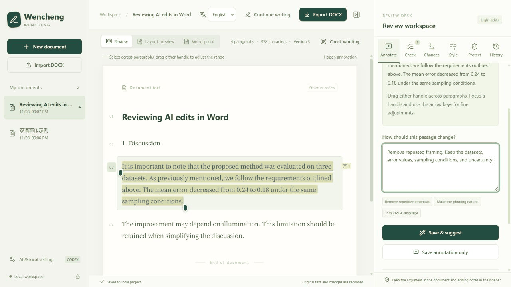

# Wencheng · 文澄

[中文](README.md)

**Bring AI writing into a reviewable Word workflow: select a passage, request an edit, compare the suggestion, and apply it as a tracked change.**

Wencheng is a local writing and review workspace for Chinese and English DOCX documents. It connects exact text selections, editing instructions, model suggestions, and native Word comments and tracked changes. The aim is to reduce repetitive framing, empty emphasis, and stiff phrasing while preserving the author's claims, terminology, citations, and uncertainty.

Use its skill from a Codex or Claude Code conversation, or call a configured model from the browser sidebar. Both paths share annotations and document versions. Wencheng does not score “AI content” or promise to evade detection.

This is an early release candidate. Browser workflows, Codex CLI, and Microsoft Word have been exercised on Windows. See [validation coverage](docs/VALIDATION.md) for platform and minimum-version limits.

[Install the skill](#install-through-skillssh) · [Download the runtime](https://github.com/yc13665193882-source/wencheng/releases/tag/v0.1.0-rc.1) · [Demo walkthrough](docs/DEMO.md) · [Report an issue](https://github.com/yc13665193882-source/wencheng/issues)



A slideshow of actual UI captures using synthetic sample text. Suggestions were generated in the current conversation and then imported; playback timing does not represent model latency. [Static screenshots and Chinese demo](docs/DEMO.md). If this workflow is useful to you, a Star helps you find the project again.

## Features

- **Precise annotations and rewriting:** select prose in the body or a table cell, attach an instruction, adjust selection boundaries, compare suggestions, and apply them individually. Compatible consecutive paragraphs can share a selection.
- **Two AI workflows:** export tasks to the current conversation and import suggestions, or use Codex CLI, Claude Code CLI, or an OpenAI-compatible endpoint in the sidebar.
- **Progressive drafting:** generate Chinese or English prose from an outline. Completed paragraphs appear in the workspace as they are saved and remain available for annotation.
- **Native Word review:** write suggestions as insertions and deletions, optionally add formal comments, undo from history, and export DOCX.
- **Style guidance and writing checks:** save the document language, terminology rules, and style samples. Review candidate issues such as empty emphasis and repeated transitions; a flag is not a verdict that the sentence must change.
- **Three reading views:** an interactive review view, an approximate layout preview, and a proof view for a user-supplied Word PDF. Chinese and English UI settings are independent of document language.

## Install through skills.sh

Requires **Python 3.11+** and **Node.js 22.20+**. Run these commands from the project where you want to use the skill. This installs into that project, without changing global skills:

```text
npx skills add yc13665193882-source/wencheng --skill wencheng --agent codex --copy --yes
python .agents/skills/wencheng/scripts/wencheng.py setup
python .agents/skills/wencheng/scripts/wencheng.py start --open
```

For Claude Code:

```text
npx skills add yc13665193882-source/wencheng --skill wencheng --agent claude-code --copy --yes
python .claude/skills/wencheng/scripts/wencheng.py setup
python .claude/skills/wencheng/scripts/wencheng.py start --open
```

Substitute `python3` if needed. The first command uses the [skills CLI](https://github.com/vercel-labs/skills) to install the skill. The second downloads the pinned `v0.1.0-rc.1` runtime, verifies its SHA256, and sets up the application and a Python virtual environment at `~/.wencheng/app-0.1.0-rc.1`. Initial setup needs access to npm, GitHub, and a Python package index. The frontend is prebuilt; running the application afterward does not require Node.js.

Reload skills or start a new conversation, then try:

> Use $wencheng to draft an English test plan from this outline. Save each completed paragraph and open a live preview. Do not invent experimental results where evidence is missing.

See [installation details](skills/wencheng/references/installation.md) for custom application directories, existing installations, and updates. `npx skills update` only updates the skill; a custom application location may need rebinding afterward. The [installation report](docs/launch/INSTALLATION-VALIDATION.md) records the tested environment and workflow.

## Start from the runtime ZIP (without Node.js)

Download the prebuilt runtime ZIP from this repository's [Releases](https://github.com/yc13665193882-source/wencheng/releases) and extract it to a directory you intend to keep. It includes the browser build, so **Node.js is not required**. Python 3.11 or later is required; initial dependency installation needs network access.

Run from the extracted directory:

```text
python scripts/setup.py
```

Setup creates an application-local `.venv` and installs Python dependencies using the included constraints. On Windows, you can also double-click `setup.cmd` to run setup. Substitute `python3` if that is the Python command on your system.

On Windows, double-click `start.cmd`. On macOS or Linux:

```sh
.venv/bin/python scripts/wencheng.py start --open
```

The browser address is `http://127.0.0.1:8765`. Add `--port PORT` to the start command to use another port. The service listens on loopback only and is intended as a personal local workspace, not a multi-user hosted service.

GitHub's automatically generated Source code archives do not include the browser build. Follow the source-development steps below for those archives.

## Install the skill from an existing application

Set up the application first, then choose the relevant destination from its directory:

```text
# Codex: current project
python scripts/install_skill.py --target .agents/skills/wencheng

# Claude Code: current project
python scripts/install_skill.py --target .claude/skills/wencheng
```

`--target` names the complete directory for this skill. It can point into another project or to a user-wide skill directory you choose. The installer has no implicit home-directory target and leaves an existing installation untouched unless you pass `--update` for a directory it previously created. Reload skills or start a new conversation afterward.

The copied skill records the application location on this machine, works from unrelated working directories, and prefers the application's `.venv`. After moving the application, rerun the installer from its new location for the same target with `--update`, or set `WENCHENG_ROOT`. See [installation and path resolution](skills/wencheng/references/installation.md).

Example requests:

> Use $wencheng to draft an English test plan from this outline. Save each completed paragraph and open the review page when finished. Do not invent experimental results where evidence is missing.

> Use $wencheng to address my annotations in this document. Prepare reviewable suggestions first, preserving terminology, citations, and the strength of each claim.

The skill writes in the current conversation. Sidebar CLI/API providers run separately and need their own working installation, authentication, or API configuration.

## Review a document

1. Import a DOCX. Wencheng stores a copy and leaves the original file untouched.
2. Select the exact passage and attach an instruction, such as “Remove repeated setup while preserving parameters and limitations.”
3. Generate a suggestion in the sidebar, or export tasks to the current conversation and import its results.
4. Compare the original and suggestion, apply accepted suggestions as Word revisions, and optionally add formal Word comments.
5. Export DOCX and continue reviewing in Word. To check actual pagination, export the current DOCX to PDF in Word and upload it to Word proof.

Tasks contain the project, version, annotation ID, exact source text, and context. A returned `quote` must match the exported source. Stale selections are rejected instead of relocating edits by guessing which repeated sentence was intended. The CLI `apply` command imports suggestions by default; `--accept` writes that batch as Word tracked changes.

## Formatting and editing limits

Wencheng patches the necessary parts of the original DOCX package rather than rebuilding the whole document from plain text. Its main editing scope is ordinary body prose and text within individual table cells. Multi-paragraph selections must stay within compatible boundaries, such as the same section and cell. Native equations, fields, footnotes/endnotes, reference entries, existing revisions, and other protected structures cannot be rewritten directly. Selections crossing protected boundaries need adjustment.

Unchanged text retains its original run formatting where possible; inserted text inherits nearby styling. A plain-text model suggestion cannot reconstruct arbitrary mixed formatting. Bookmarks, comments, and page breaks can also constrain selections. Reference and citation protection uses heuristics, so unusual formats still need manual review.

**The browser layout preview is not Word's layout engine.** It uses `docx-preview` and cannot guarantee identical fonts, automatic pagination, field calculation, or complex objects. Missing pagination caches or overflow are marked as a flowing reference view; special page numbering is labeled as cached. Installed fonts also affect rendering.

Word proof displays the actual pages of an uploaded PDF and binds it to the DOCX content at upload time. Later changes mark the proof as outdated. It does not launch Word or verify that the PDF came from that DOCX. Proof pages are read-only; edit text in the review view. Current PDF limits are 50 MB and 300 pages.

Passing the tested samples does not establish lossless round trips for every DOCX or equivalent compatibility with WPS or LibreOffice. See [validation and reproduction](docs/VALIDATION.md).

## Data and model calls

By default, application-local `.wencheng/` holds original and current DOCX files, annotations, history snapshots, and uploaded proofs. `WENCHENG_DATA` can select another directory. The server, skill, and CLI must inherit the same setting to share projects.

Model calls send the selection, necessary context, instructions, and style settings to the chosen provider. Drafting sends writing requirements and relevant context. Whether that data leaves the machine depends on the provider. API settings store an environment-variable name rather than the API key; the server process must inherit that variable. CLI providers use their own local authentication.

Real Chinese and English generation and rewriting have been verified through Codex CLI. Claude Code and OpenAI-compatible adapters have protocol-level mock coverage but have not completed equivalent acceptance with a real Claude account or a real compatible endpoint.

## Develop from source

Requirements: Python 3.11+, Node.js 22.12+, and npm. From the repository root:

```text
python scripts/setup.py
npm ci
npm run build
```

Start using the commands above. The frontend uses React and TypeScript; the backend uses Flask. DOCX handling uses lxml and python-docx, and PDF proofs use PDFium.

Backend tests on Windows:

```powershell
.venv\Scripts\python.exe -m unittest discover -s tests -v
```

Backend tests on macOS or Linux:

```sh
.venv/bin/python -m unittest discover -s tests -v
```

Frontend regression tests and production build:

```text
node --experimental-strip-types --test frontend/tests/*.test.ts
npm run build
```

The public repository includes synthetic DOCX fixtures, automated checks, and UI demonstrations using synthetic content. Third-party paper copies, private projects, model-run artifacts, and private acceptance screenshots are not distributed in the repository or runtime ZIP.

## License

Wencheng is released under the [MIT License](LICENSE). Third-party dependencies retain their own licenses; the runtime archive includes dependency license notices.
