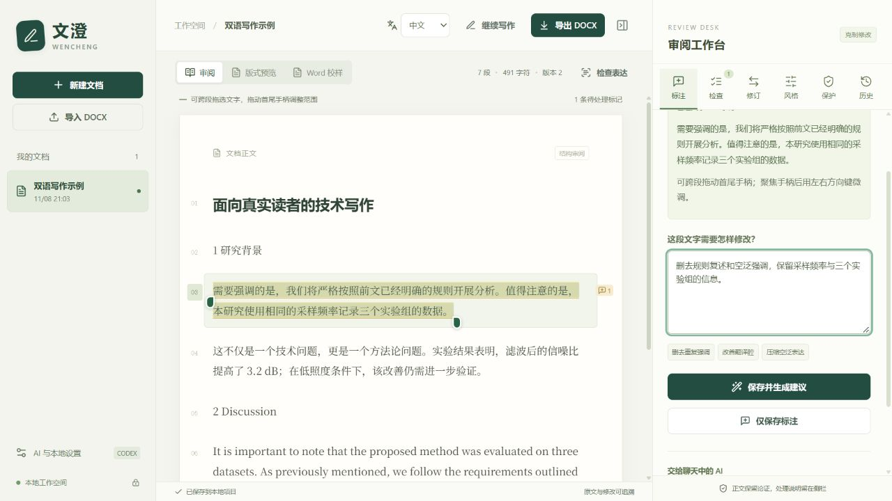
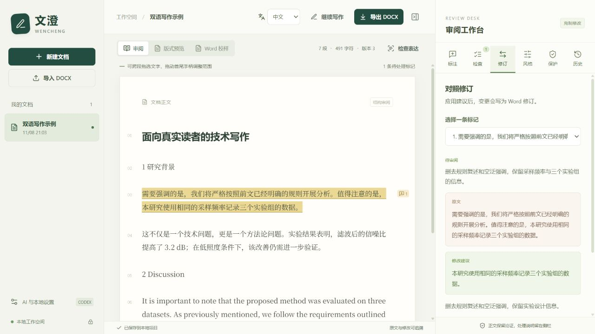
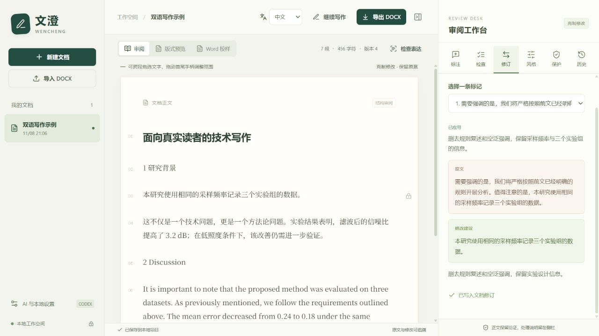
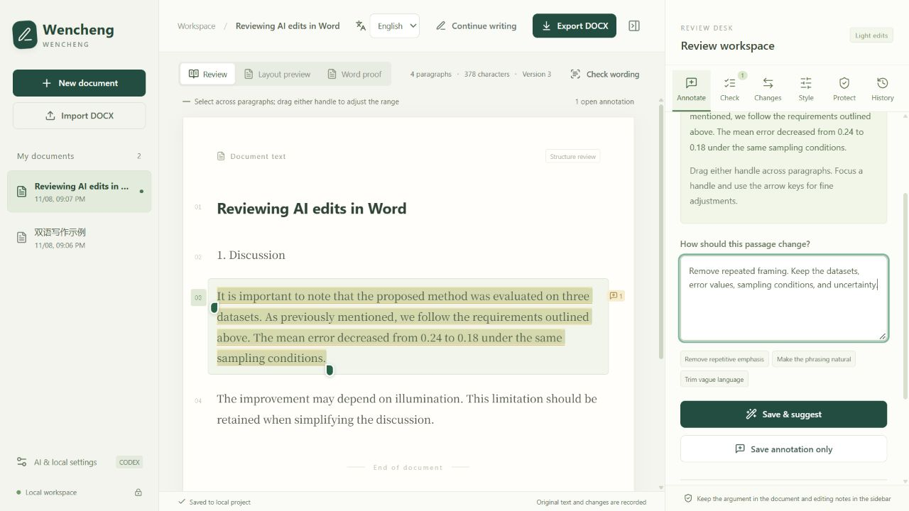
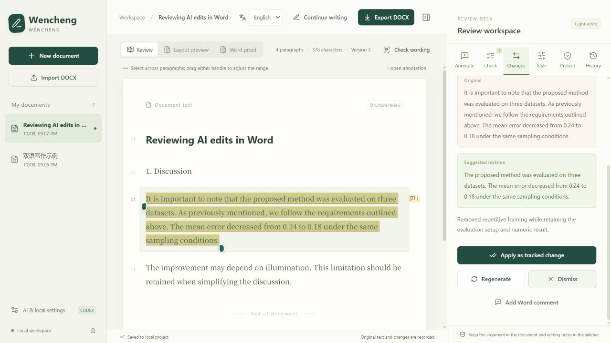
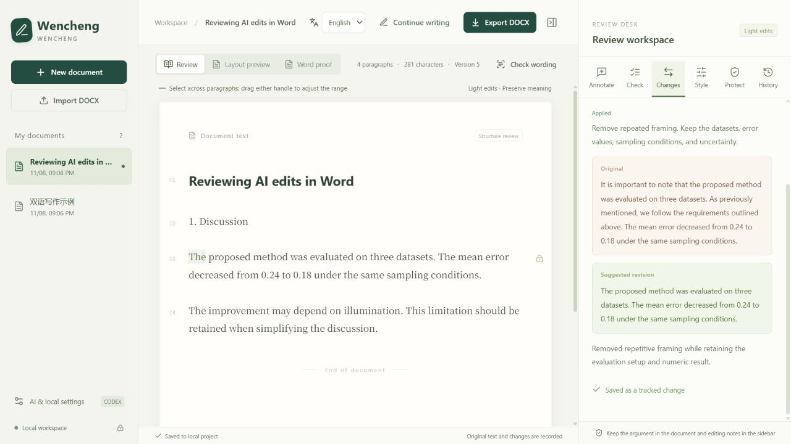

# 文澄演示 · Wencheng demo

[中文首页](../README.md) · [English README](../README.en.md)

这些是 2026-11-08 在真实工作台中截取的操作画面，仅使用合成样例。建议由当前对话生成，经任务接口导入，再在浏览器中应用。GIF 将三个操作状态串联为轮播，不是连续录屏，也不代表模型响应速度。

These UI captures were taken on 2026-11-08 using synthetic samples. Suggestions were generated in the current conversation, imported through the task interface, and applied in the browser. Each GIF is a slideshow of three states, not a continuous recording or a model-speed benchmark.

## 中文：删去重复交代

1. 选中原文，标注“删去规则复述和空泛强调，保留采样频率与三个实验组的信息”。

2. 比较原文和建议，确认实验设计信息保留。

3. 应用为 Word 修订。正文显示改稿，审阅记录保留；导出的 Word 文档仍可继续接受或拒绝修订。

## English: simplify framing, retain the result

1. Select a passage and request removal of repeated framing while retaining the datasets, numeric result, sampling conditions, and uncertainty.

2. Review the proposed change alongside the original. The result still reports three datasets and a mean error change from 0.24 to 0.18; these numbers are synthetic, not research findings.

3. Apply the suggestion as a Word tracked change and optionally add a formal Word comment. DOCX export was downloaded through the browser during this demo.

## 复现 · Try it

按首页安装步骤启动，点击“先打开双语示例，熟悉审阅流程”或 “Open the bilingual sample to try the review workflow”，在审阅视图中选择文字并保存指令。在当前聊天处理标记或使用配置好的侧栏提供方，比较建议后应用，再导出 DOCX。

Follow the README installation steps, open the built-in bilingual sample, select text in the review view, and save an instruction. Process the annotation in your conversation or through a configured sidebar provider, compare the suggestion, apply it, and export DOCX.

浏览器辅助版式预览与 Word 排版存在差异。此次演示展示审阅流程；安装验证、真实模型调用和 Word 排版检查的范围分别见[安装报告](launch/INSTALLATION-VALIDATION.md)与[验收概览](VALIDATION.md)。

The browser layout preview differs from Word. These captures demonstrate the review workflow. See the [installation report](launch/INSTALLATION-VALIDATION.md) and [validation overview](VALIDATION.md) for the separate coverage of installation, real model calls, and Word layout checks.
